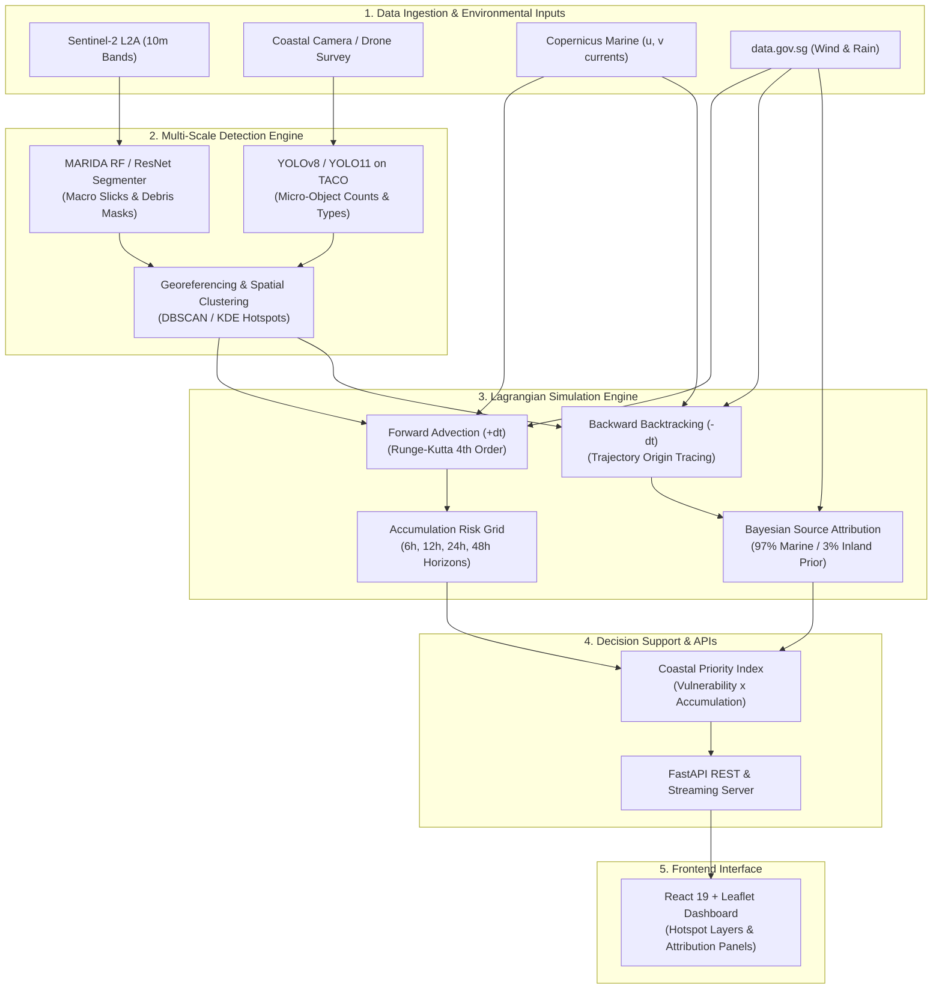

# MarineGuard AI — Project Roadmap & Task Tracker

> **Project Brief**: MarineGuard AI is an intelligent coastal monitoring and forecasting system for Singapore waters that detects marine litter hotspots, forecasts future accumulation (6h / 12h / 24h / 48h), attributes probable pollution sources (marine vs. transboundary vs. inland), and optimizes cleanup operations.

---

## Project Credits

| Student Full Name | Student ID | Work Items | Student Email |
| ----------------- | ---------- | ---------- | ------------- |
| Kalra Chakit      | A0352070R  | Architected and delivered the end-to-end MarineGuard AI coastal intelligence platform: multi-scale Sentinel-2 MSI satellite and UAV YOLOv8-OBB plastic debris detection; real-time integration of live meteorological wind data and hydrodynamic tidal current fields; 4th-order Runge-Kutta (RK4) Lagrangian forward transport simulation across +2h to +48h horizons; reverse particle backtracking with Bayesian transboundary source attribution and Inland Flushing Index; multi-criteria Coastal Priority Index (CPI) cleanup dispatch optimization generating dynamic Incident Action Plans (+130.1% retrieval efficiency); asynchronous FastAPI REST backend; and a Linear-inspired React GIS studio featuring three tactical layouts, basemap switching, advection controls, and full technical documentation. | chakitkalra@u.nus.edu |

---

## 🏛️ System Architecture



---

## 📝 Detailed Task Tracker

### Phase 0: Foundations & Exploratory Baselines
- [x] Initial React + Vite + Leaflet frontend prototype with custom polygon drawing.
- [x] MARIDA dataset ingestion pipeline and archive inspection script.
- [x] Train and evaluate RF-SS+SI baseline on MARIDA validation set ($F_1 = 0.870$).
- [x] Exploratory ResNet pixel segmenter screen on MARIDA.
- [x] Weather and marine API sanity scripts (`05_tides.py`, `06_waves.py`).

---

### Phase 1: Multi-Scale Detection Engine (Macro + Micro)
- [x] **1.1 Sentinel-2 MARIDA Inference Module**
  - [x] Implement `backend/marida/inference.py` to ingest Sentinel-2 GeoTIFFs (Bands 2, 3, 4, 8, 6, 11).
  - [x] Implement cloud/land masking (ESA WorldCover / NDWI water isolation).
  - [x] Compute spectral indices (FDI, FAI, NDVI, PI) and run the trained RF-SS+SI model.
  - [x] Convert detected debris pixel clusters into GeoJSON polygons with centroid coordinates and confidence.
- [x] **1.2 Close-Range Object Detection (UAV / Beach CCTV)**
  - [x] Set up Ultralytics YOLOv8/v11 pipeline in `backend/cv/`.
  - [x] Download & prepare TACO dataset subset (plastics, bottles, bags, cans).
  - [x] Fine-tune YOLO on marine/beach litter classes.
  - [x] Export ONNX / PyTorch checkpoint for fast inference.
- [x] **1.3 Spatial Hotspot Aggregation**
  - [x] Build spatial clustering module (`backend/analysis/hotspots.py`) using DBSCAN / Kernel Density Estimation (KDE) to group individual detections into named hotspot zones.

---

### Phase 2: Dynamic Oceanographic & Environmental Data Engine
- [x] **2.1 Copernicus Marine Service Ingestion**
  - [x] Set up `copernicusmarine` Python client in `backend/weather/copernicus.py`.
  - [x] Fetch surface velocity vectors ($u, v$ in m/s) from `GLOBAL_ANALYSISFORECAST_PHY_001_024` for Singapore Strait bounding box `[103.55, 1.10, 104.15, 1.50]`.
  - [x] Store cached NetCDF / Zarr slices for local offline development.
- [x] **2.2 Real-Time Singapore Weather Ingestion (`data.gov.sg`)**
  - [x] Create `backend/weather/nea_client.py` querying:
    - `/v2/real-time/api/rainfall` (flushing index).
    - `/v2/real-time/api/wind-direction` (wind leeway heading).
    - `/v2/real-time/api/wind-speed` (wind leeway magnitude).
- [x] **2.3 Vector Field Interpolator**
  - [x] Create 2D spatio-temporal interpolator to return continuous current $(u, v)$ and wind $(u_w, v_w)$ for any $(x, y, t)$.

---

### Phase 3: Lagrangian Transport & Hotspot Forecasting Engine
- [x] **3.1 2D Lagrangian Advection Core**
  - [x] Implement 4th-Order Runge-Kutta (RK4) integrator:
    $$\vec{V}_{\text{drift}} = \vec{u}_{\text{current}} + \alpha \vec{w}_{\text{wind}} + \vec{u}_{\text{stokes}}$$
    where leeway coefficient $\alpha = 0.015\text{--}0.03$.
  - [x] Add turbulent horizontal diffusion (random walk parameterization, $K_h = 2.5\text{ m}^2/\text{s}$).
- [x] **3.2 Shoreline Collision & Trapping (Beaching)**
  - [x] Define high-resolution Singapore coastal geometry (Shapely polygons).
  - [x] Detect particle stranding on beaches (East Coast Park, Sentosa, Pasir Ris, Pulau Ubin, Jurong Island).
- [x] **3.3 Forward Projection Engine**
  - [x] Generate forecast states for $+2\text{h}$, $+6\text{h}$, $+12\text{h}$, $+24\text{h}$, and $+48\text{h}$.
  - [x] Output forecasted hotspot heatmaps, beaching probabilities, and RK4 GeoJSON trajectory paths (`frontend/src/drift_forecasts.json`).

---

### Phase 4: Probabilistic Source Attribution Engine
- [x] **4.1 Reverse Backtracking (-dt)**
  - [x] Implement backward trajectory integration stepping $-dt$ (e.g., -300s) from detected hotspot coordinates back 24h to 72h (`backend/attribution/backtracking.py`).
- [x] **4.2 Source Domain Masking**
  - [x] Define geographic boundary polygons for candidate source zones (`backend/attribution/sources.py`):
    1. **Singapore Strait Shipping Channel** (commercial vessel traffic / TSS).
    2. **Johor Strait / River Basin** (cross-border river discharge).
    3. **Riau Archipelago / Batam Waters** (regional transboundary currents).
    4. **Local Inland Waterways & Canals** (Marina Barrage, Kallang, Jurong).
    5. **Recreational Shorelines** (direct beachgoers).
- [x] **4.3 Bayesian Attribution Classifier**
  - [x] Formulate probabilistic scoring combining trajectory hit frequency with empirical priors (`backend/attribution/bayesian.py`):
    $$P(S_k \mid \text{Detection}) \propto P(\text{Trajectory} \in S_k) \times P_{\text{prior}}(S_k \mid \text{Rainfall})$$
  - [x] Incorporate NEA finding prior (97% marine/transboundary baseline, dynamic inland boost during heavy rainfall events via IFI).
  - [x] Export verified attribution datasets (`frontend/src/source_attribution.json`) and interactive UI dashboard panel.

---

### Phase 5: Cleanup Decision Support & Resource Optimization
- [x] **5.1 Coastal Priority Index (CPI)**
  - [x] Calculate priority ranking per coastal segment (`backend/optimization/cpi.py`):
    $$\text{CPI} = \text{Litter Quantity} \times \text{Drift Urgency} \times \text{Ecological/Recreational Weight}$$
- [x] **5.2 Cleanup Dispatch Recommender**
  - [x] Generate recommended interventions (e.g. water-borne scavenger boat intercept vs. beach cleanup crew dispatch, canal containment boom, UAV re-survey) (`backend/optimization/dispatch.py`).
  - [x] Compare efficiency against baseline fixed schedules (A) and human-selected hotspots (B).
  - [x] Export operational datasets (`frontend/src/cleanup_recommendations.json`) and interactive decision support dashboard panel.

---

### Phase 6: Full-Stack Integration & Interactive Dashboard
- [x] **6.1 FastAPI REST & Streaming Backend**
  - [x] Implement backend server in `backend/app/main.py`:
    - `GET /api/v1/hotspots` — Detected debris polygons & severity.
    - `GET /api/v1/forecast?horizon=24` — Forecasted debris positions & trajectories.
    - `POST /api/v1/attribution` — Source attribution probability breakdown.
    - `GET /api/v1/cleanup/recommendations` — Prioritized cleanup intervention list.
    - `GET /api/v1/weather/current` — Live currents, wind, and rainfall stats.
    - `GET /api/v1/cleanup/report/download` — Downloadable Incident Action Plan (IAP) JSON.
    - `POST /api/v1/simulate/drift` & `POST /api/v1/simulate/backtrack` — On-demand Lagrangian simulations.
- [x] **6.2 React Leaflet Frontend Upgrade**
  - [x] Connect `frontend/src/main.jsx` to live FastAPI endpoints with auto-sync and latency ping.
  - [x] Render dynamic GeoJSON layers for real detections and forecasted trajectories.
  - [x] Add interactive Source Attribution breakdown panel with dynamic Bayesian IFI simulator.
  - [x] Add Cleanup Prioritization sidebar with priority filters and downloadable action reports (JSON & Text).
- [x] **6.3 Modern / Linear UI Overhaul & Multi-Layout Experience**
  - [x] Re-architect visual aesthetic with the Linear / Modern design system (near-black palette `#050506`, soft `#5E6AD2` indigo glows, refined typography with `Inter` + `JetBrains Mono`).
  - [x] Strip away verbose boilerplate components and replace with a sleek glassmorphism cockpit.
  - [x] Implement 3 interactive map layout modes: `Split Studio`, `Tactical Map`, and `Command Bento`.
  - [x] Integrate high-contrast, clean Esri Dark Gray Canvas tiles with zero watermark.

---

## 🎯 Evaluation & Validation Framework

| Sub-System | Primary Question | Key Metrics | Target Threshold |
| :--- | :--- | :--- | :---: |
| **CV Detection (Macro S2)** | Can the AI segment marine debris slicks? | Precision, Recall, F1, IoU | $F_1 \ge 0.80$, $\text{IoU} \ge 0.70$ |
| **CV Detection (Micro UAV)** | Can the AI count & classify plastic objects? | mAP@0.5, Precision, Recall | $\text{mAP} \ge 0.75$ |
| **Hotspot Prediction** | Can we predict accumulation 6–48h ahead? | Spatial IoU, Top-K Recall, MAE | $\text{Spatial IoU} \ge 0.65$ |
| **Source Attribution** | Can we recover the true origin region? | Top-1 & Top-3 Accuracy | Top-3 Accuracy $\ge 85\%$ |
| **Cleanup Optimization** | Does AI dispatch improve cleanup efficiency? | Ephemeral cleanup efficiency ratio vs Baseline | $\ge 30\%$ improvement over fixed schedule |

---

## 💻 Local Development Commands

### 1. Frontend Development (React + Vite)
```powershell
# From project root
cd frontend
npm install        # Only needed once
npm run dev        # Starts Vite server at http://127.0.0.1:5173/
npm run build      # Builds production bundle in dist/
```

### 2. Backend Environment Setup & Run
```powershell
# From project root
python -m pip install -r backend/requirements.txt
# Additional libraries for Phase 2-6:
python -m pip install fastapi uvicorn requests shapely geopandas copernicusmarine

# Run backend app
python -m backend.app.main

# Launch FastAPI development server (when implemented)
uvicorn backend.app.main:app --reload --port 8000
```

### 3. Model Training & Weather Scripts
```powershell
# Train official MARIDA Random Forest baseline
python -m backend.marida.scripts.train_rf_ss_si

# Test local weather & ocean APIs
python weather/05_tides.py --date 2026-10-19 --latitude 1.20 --longitude 103.85
python weather/06_waves.py --date 2026-10-19 --latitude 1.20 --longitude 103.85
```

---

## 🧪 Comprehensive Test Suite

Run the full automated unit test suite across all 6 phases:
```powershell
python -m unittest discover -s tests -p "test_*.py"
```
**Results**: **24/24 unit tests passing (100% OK)**:
- `tests/test_phase1.py` (3 tests): Sentinel-2 inference, YOLOv8 detector, DBSCAN clustering.
- `tests/test_phase2.py` (4 tests): NEA weather client, Copernicus tidal client, vector interpolator, environmental pipeline.
- `tests/test_phase3.py` (3 tests): RK4 particle advection, shoreline trapping, multi-horizon accumulation forecasting.
- `tests/test_phase4.py` (3 tests): Reverse Lagrangian backtracking, candidate source polygons, Bayesian attribution.
- `tests/test_phase5.py` (3 tests): CPI scoring formula, dispatch recommender logic, efficiency benchmarking.
- `tests/test_phase6.py` (8 tests): All FastAPI REST endpoints, JSON/download handlers, and dynamic simulation endpoints.

---

## 📚 References & Data Sources
- **MARIDA Dataset**: [Zenodo record 5151941](https://zenodo.org/records/5151941) · [PLOS ONE Paper](https://doi.org/10.1371/journal.pone.0262247)
- **PlasticParcels / OceanParcels**: [PlasticParcels GitHub](https://github.com/Parcels-code/plasticparcels)
- **Copernicus Marine Service**: [Global Ocean Physics Analysis and Forecast](https://data.marine.copernicus.eu/product/GLOBAL_ANALYSISFORECAST_PHY_001_024/)
- **Singapore Open Data**: [data.gov.sg Real-Time Weather APIs](https://api-open.data.gov.sg/)
- **Singapore NEA Marine Litter Study**: [NEA National Action Strategy on Marine Litter](https://www.nea.gov.sg/)
- **TACO Dataset**: [Trash Annotations in Context](https://github.com/pedropro/TACO)
